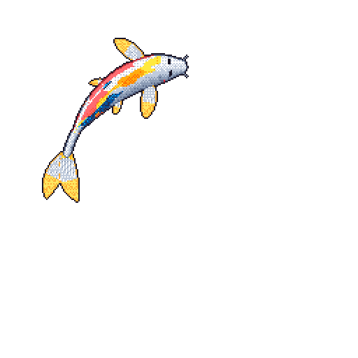

Computer Science Master’s student at the University of Catania and member of the [LIVE@IPLAB](https://iplab.dmi.unict.it/live/) research group. 

Visit my [website](https://danielemateria.github.io) for more info :)

  

<!---
  // ////          //              //
  //     ///       //  //      //  //
  //        //     //    //  //    //
  //        //     //      //      //
  //        //     //              //
  //     ///       //              //
  // ////          //              //
--->
